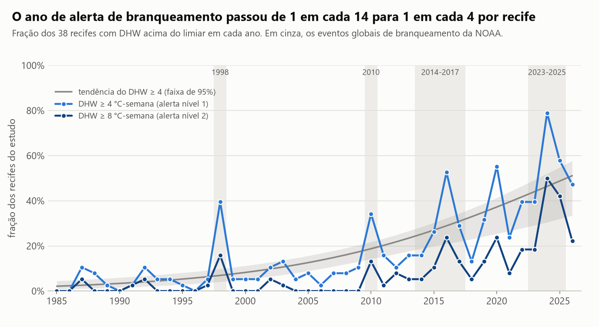
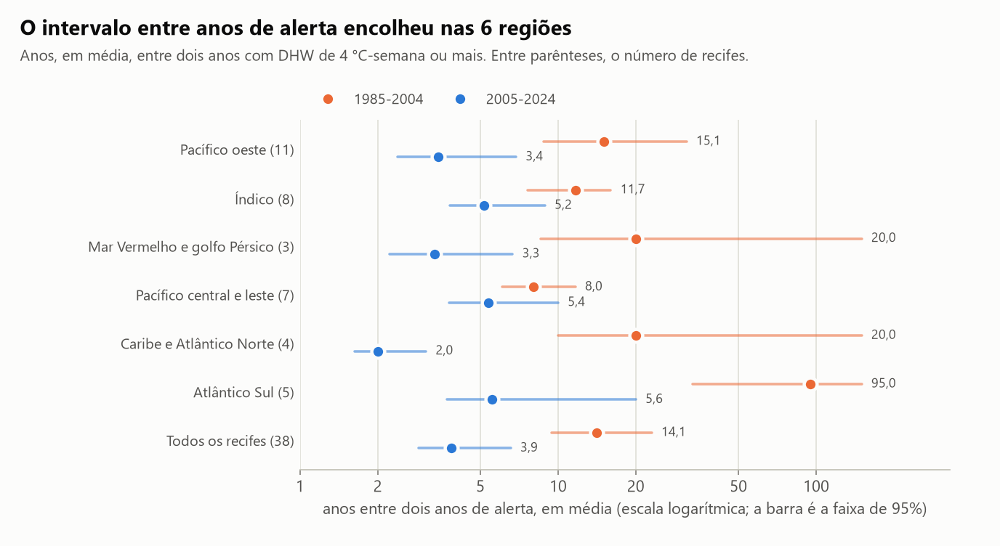
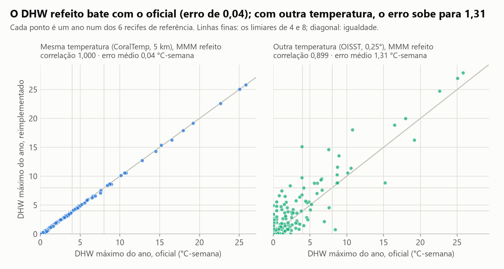
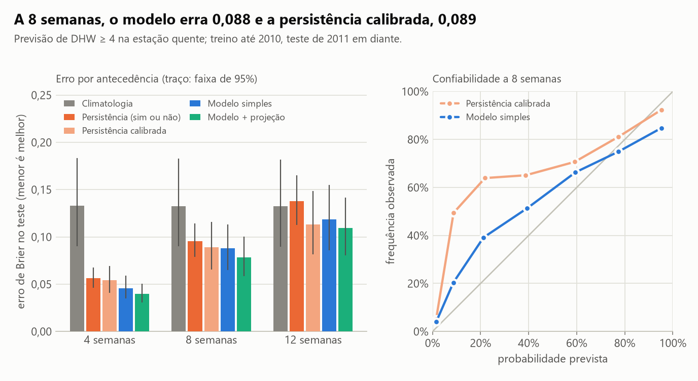
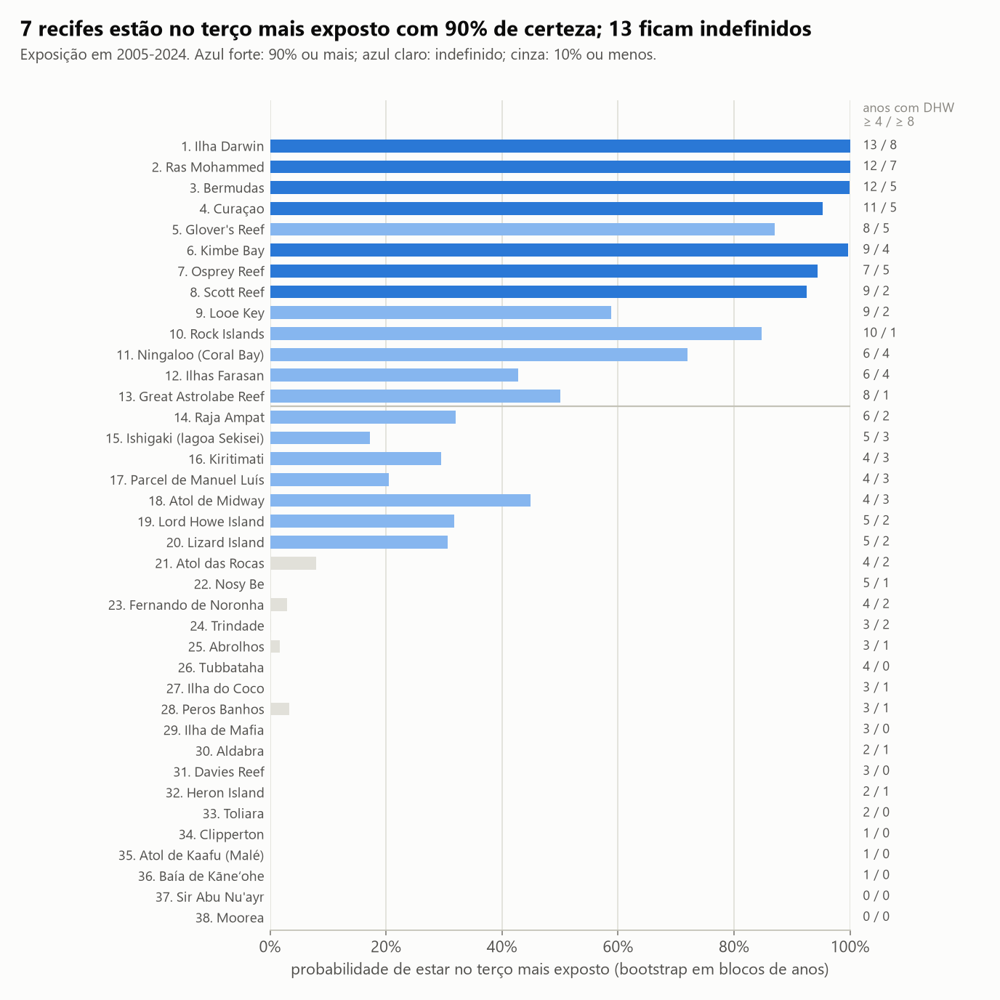
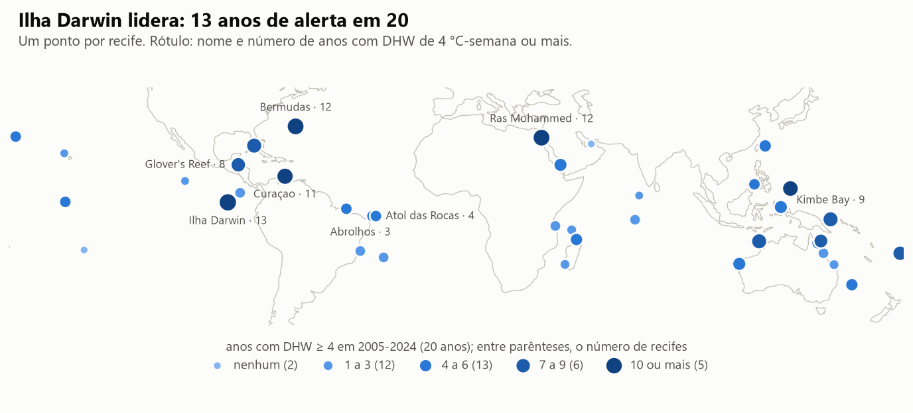

# Em quais recifes o estresse térmico que branqueia corais chega mais cedo e mais vezes, e dá para avisar com antecedência?

Corais branqueiam quando a água fica quente demais por tempo demais. A NOAA Coral Reef Watch mede isso por satélite
com o Degree Heating Week (DHW): quanto a temperatura passou do máximo normal do lugar, acumulado em 12 semanas. A
decisão que este estudo informa é que recifes priorizar para monitoramento e resposta, e com quantas semanas de
antecedência um alerta simples é confiável.

**A resposta, com o que os dados públicos sustentam:** em 38 recifes de seis bacias, um ano de alerta de
branqueamento (DHW de 4 °C-semana ou mais) vinha a cada **14,1 anos** por recife em 1985-2004 e passou a vir a cada
**3,9 anos** em 2005-2024; as chances de um ano assim multiplicam por 2,57 a cada década (IC 95%: 1,84 a 3,37). Um
alerta simples é confiável com 4 semanas de antecedência (85% dos alertas se confirmam e 72% dos eventos são
avisados); com 8 semanas o modelo empata com a persistência da anomalia, e com 12 perde. E o topo do ranking de
exposição (Galápagos, norte do Mar Vermelho, Bermudas) não é o topo do branqueamento visto em campo: exposição
térmica não é branqueamento.

É análise de dado público, feita por um profissional de dados. Não é previsão oficial nem descoberta.

## Em 30 segundos

- **O método foi conferido antes de ser usado.** O DHW refeito a partir da temperatura diária reproduz o produto
  oficial da NOAA: com a mesma temperatura, o erro do máximo anual é de 0,01 °C-semana e a concordância em "passou
  de 4" é de 100% em 249 recifes-ano. O MMM (o máximo normal do lugar) recalculado nos 38 recifes fica a no máximo
  0,006 °C do oficial; sem o passo de recentrar a climatologia, ficaria 0,16 °C mais quente.
- **Trocar o produto de temperatura muda o resultado.** Com o OISST (grade de 0,25°) no lugar do CoralTemp (5 km),
  o erro do máximo anual sobe para 1,31 °C-semana e 25 de 215 recifes-ano trocam de lado no limiar de 4. Em Abrolhos,
  o maior DHW da série é 15,2 no produto oficial e 8,9 no OISST.
- **A tendência é clara no conjunto e incerta recife a recife.** No conjunto, a frequência do ano de alerta ficou
  3,7 vezes maior (IC 95%: 1,8 a 6,3) e a do ano severo (DHW de 8 ou mais) passou de um a cada 48,9 anos para um a
  cada 9,2. Recife a recife, 24 dos 38 têm tendência com p abaixo de 5%; depois da correção para múltiplas
  comparações ficam 16.
- **Os eventos globais de branqueamento aparecem.** A fração dos recifes do estudo em alerta foi de 39% em 1998,
  34% em 2010, 53% em 2016 e 79% em 2024. Mas 2020 (55%) e 2022 (39%), que não são eventos globais declarados,
  ficam no mesmo nível de 1998.
- **A persistência é difícil de bater.** Para prever o alerta, um modelo simples ganha da persistência da anomalia
  com 4 semanas, empata com 8 e perde com 12. O índice Niño 3.4 não acrescentou nada mensurável.
- **O ranking tem topo e fundo firmes e um meio indefinido.** 7 recifes estão no terço mais exposto com 90% de
  certeza, 18 estão fora dele com a mesma certeza e 13 ficam indefinidos.
- **O satélite acompanha o campo, mas menos do que parece.** Em 2.857 levantamentos de campo perto dos recifes, o
  DHW separa os que tinham branqueamento dos que não tinham com AUC de 0,74 (0,65 a 0,80). Só com os levantamentos
  de rotina do Reef Check, a AUC cai para 0,59 (0,47 a 0,71), que não se distingue do acaso.

## As figuras

### 1. A fração dos recifes em alerta, ano a ano



Para cada recife e cada ano de estresse (a janela de 12 meses em torno do mês mais quente do lugar), vale o maior
DHW oficial. A linha azul é a fração dos 38 recifes em que esse máximo passou de 4 °C-semana (alerta nível 1 da
NOAA, risco de branqueamento no recife inteiro); a azul-escura, de 8 (nível 2, branqueamento com mortalidade). A
curva cinza é a regressão logística da fração sobre o ano, com a faixa de 95% de um bootstrap que sorteia anos
inteiros em blocos de quatro.

| Evento global declarado pela NOAA | Maior fração com DHW ≥ 4 | Maior fração com DHW ≥ 8 |
|---|---|---|
| 1998 | 39% | 16% |
| 2010 | 34% | 13% |
| 2014-2017 | 53% | 24% |
| 2023-2025 | 79% | 50% |

Nos anos de evento global, a fração média em alerta é de 42%; nos outros, 12%. A NOAA informa que 68,2% da área
de recifes do mundo teve estresse no nível de branqueamento em 2014-2017 e 84,4% de janeiro de 2023 a setembro de
2025. Os números daqui não são comparáveis um a um com esses: são 38 pontos escolhidos à mão e um ano por vez, não
a área de recifes ao longo de um evento inteiro. O que confere é a ordem: cada evento global atinge mais recifes
que o anterior. O que os eventos declarados não contam: 2019, 2020, 2021, 2022 e 2026 também têm 20% ou mais dos
recifes em alerta.

### 2. O intervalo de retorno, antes e depois de 2005



O intervalo de retorno é o número médio de anos entre dois anos de alerta: o inverso da frequência.

| Recorte | Recifes | 1985-2004 (IC 95%) | 2005-2024 (IC 95%) | Frequência: depois / antes (IC 95%) |
|---|---|---|---|---|
| **Todos os recifes** | 38 | 14,1 (9,4 a 23,0) | 3,9 (2,9 a 6,6) | 3,7 (1,8 a 6,3) |
| Pacífico oeste | 11 | 15,1 (8,8 a 31,4) | 3,4 (2,4 a 6,9) | 4,4 (1,9 a 9,6) |
| Índico | 8 | 11,7 (7,6 a 16,0) | 5,2 (3,8 a 8,9) | 2,3 (1,1 a 3,5) |
| Mar Vermelho e golfo Pérsico | 3 | 20,0 (8,6 a sem limite) | 3,3 (2,2 a 6,7) | 6,0 (2,0 a 22,0) |
| Pacífico central e leste | 7 | 8,0 (6,1 a 11,7) | 5,4 (3,8 a 10,0) | 1,5 (0,7 a 2,4) |
| Caribe e Atlântico Norte | 4 | 20,0 (10,0 a sem limite) | 2,0 (1,6 a 3,1) | 10,0 (4,2 a 23,0) |
| Atlântico Sul | 5 | 95,0 (33,3 a sem limite) | 5,6 (3,7 a 20,0) | 17,1 (2,5 a 26,0) |

O intervalo encolheu nas seis regiões, mas com certezas diferentes. No Pacífico central e leste, onde o El Niño já
trazia estresse nos anos 1980 e 1990 (Kiritimati, Galápagos), o intervalo da razão inclui 1: os dados não mostram
piora ali. No Atlântico Sul (os cinco recifes brasileiros) houve um único ano de alerta em 95 recifes-ano antes de
2005 e 18 em 100 depois; a razão de 17 tem um intervalo enorme porque parte de quase zero. Para o ano severo (DHW
de 8 ou mais), o conjunto passou de 48,9 anos (29,2 a 95,0) para 9,2 (6,6 a 21,7).

Hughes et al. (2018) mediram coisa parecida com dado de campo: em 100 recifes, o intervalo mediano entre
branqueamentos severos caiu para cerca de 6 anos em 2016. O número daqui é de estresse térmico por satélite, não de
branqueamento, e vai na mesma direção.

### 3. O DHW refeito contra o oficial



Refazer o índice é o teste de que o método foi entendido. São cinco degraus, do mais controlado ao menos:

| Degrau | Recifes-ano | Correlação | Viés | Erro médio | Erro máximo | Concordância em DHW ≥ 4 (kappa) | Só o refeito / só o oficial |
|---|---|---|---|---|---|---|---|
| Algoritmo: temperatura e MMM oficiais, diário | 249 | 1,000 | −0,01 | 0,01 | 0,29 | 100,0% (1,00) | 0 / 0 |
| Climatologia: mesma temperatura, MMM refeito | 249 | 1,000 | −0,03 | 0,04 | 0,45 | 100,0% (1,00) | 0 / 0 |
| Outro produto: OISST diário, MMM do OISST | 215 | 0,899 | 0,67 | 1,31 | 11,24 | 88,4% (0,63) | 20 / 5 |
| Semanal: uma temperatura a cada 7 dias, MMM oficial | 1.568 | 0,984 | 0,03 | 0,42 | 3,85 | 96,1% (0,87) | 42 / 19 |
| Produto oficial lido 1 dia em 7, contra todos os dias | 249 | 1,000 | −0,01 | 0,01 | 1,29 | 100,0% (1,00) | 0 / 0 |

Os três primeiros degraus usam os seis recifes de referência, que têm a série diária; o quarto, os 38.

- **O algoritmo fecha.** Em quatro dos seis recifes, o DHW diário refeito difere do oficial em no máximo 0,004
  °C-semana, que é arredondamento. Nos outros dois (Maldivas e Abrolhos) as diferenças vêm em blocos de exatamente
  84 dias e cerca de 0,14 °C-semana: é a assinatura de um único dia em que o HotSpot fica no limiar de 1 °C (0,99
  ou 1,00 com os valores arredondados a duas casas) e entra na soma de um lado e não do outro.
- **A climatologia fecha.** O MMM recalculado a partir da média mensal do CoralTemp (1985-2012, recentrada pela
  tendência para 1988,286, como na metodologia da NOAA) difere do oficial em 0,0025 °C em média e 0,006 °C no pior
  dos 38 recifes. Sem recentrar, o MMM sairia 0,16 °C mais quente em média, e todo DHW sairia menor.
- **O produto de temperatura não fecha, e isso é o achado.** O OISST tem grade de 0,25° (cerca de 28 km) e mistura
  satélite com boias e navios; o CoralTemp tem 5 km e só usa satélite à noite. O MMM dos dois difere em até 0,36 °C
  (Abrolhos: 26,94 no CoralTemp e 27,30 no OISST, numa célula a 13 km do recife). Como o DHW só soma o que passa
  de 1 °C acima do MMM, décimos de grau viram vários °C-semana.
- **Ler o produto oficial um dia por semana quase não perde nada.** O máximo anual lido em uma data a cada 7 difere
  do lido todos os dias em 0,01 °C-semana em média, e nenhum recife-ano troca de lado no limiar de 4. Por isso a
  análise dos 38 recifes usa a leitura semanal (ver "Onde este estudo falha").

| Recife de referência | MMM oficial | MMM refeito | MMM do OISST | Erro diário do algoritmo | Erro diário com o OISST | Maior DHW: oficial | Maior DHW: OISST |
|---|---|---|---|---|---|---|---|
| Lizard Island | 28,58 | 28,57 | 28,60 | 0,0006 | 0,38 | 8,66 | 10,26 |
| Atol de Kaafu (Malé) | 29,68 | 29,68 | 29,46 | 0,0019 | 0,16 | 6,64 | 8,94 |
| Sir Abu Nu'ayr | 33,66 | 33,66 | 33,56 | 0,0004 | 0,27 | 7,59 | 8,36 |
| Kiritimati | 27,97 | 27,97 | 27,78 | 0,0007 | 0,84 | 25,81 | 27,92 |
| Looe Key | 29,64 | 29,64 | 29,45 | 0,0006 | 0,26 | 17,97 | 20,03 |
| Abrolhos | 26,94 | 26,94 | 27,30 | 0,0104 | 0,27 | 15,20 | 8,88 |

### 4. Dá para avisar com antecedência?



O alvo: na data-alvo, dentro da estação quente, o DHW do recife estará em 4 ou mais? As previsões são emitidas 4,
8 e 12 semanas antes, com treino até 2010 e teste de 2011 a 2026. A tabela completa está em "Comparação com a
alternativa simples". A curva da direita mostra um problema que as duas previsões têm: quando dizem 20%, o evento
acontece em 39% (modelo) ou 64% (persistência calibrada) das vezes. A frequência do alerta foi de 2,9% no treino e
de 14,9% no teste; quem aprende a taxa de base no passado subestima o presente.

### 5. O ranking de exposição e a sua incerteza



A exposição em 2005-2024 é a fração de anos com DHW de 4 ou mais, somada à fração com 8 ou mais (o ano severo conta
em dobro). A barra é a probabilidade de o recife estar entre os 13 mais expostos quando os 20 anos são sorteados de
novo, em blocos de quatro e os mesmos para todos os recifes. A tabela completa, por recife, está mais abaixo e em
[`reports/exposicao_por_recife.csv`](reports/exposicao_por_recife.csv).

Sete recifes ficam no terço mais exposto em 90% ou mais dos sorteios: Ilha Darwin (Galápagos), Ras Mohammed (norte
do Mar Vermelho), Bermudas, Curaçao, Kimbe Bay, Osprey Reef e Scott Reef. Dezoito ficam fora em 90% ou mais. Os
outros 13 não têm posto definido: Looe Key, nas Florida Keys, é o 9º e tem 59% de probabilidade de estar no terço.

**Este ranking não é um ranking de dano.** Três dos primeiros lugares são casos em que a literatura ou os próprios
levantamentos de campo dizem o contrário do que o satélite sugere:

- **Ras Mohammed**, 2º lugar, com 12 anos de alerta em 20. O norte do Mar Vermelho é descrito como refúgio de
  corais com limiar de branqueamento excepcionalmente alto (Fine et al. 2013). Nos 199 conjuntos de levantamentos
  de campo a até 100 km do ponto, com DHW de até 9,2, só 1 registra 10% ou mais de coral branqueado.
- **Ilha Darwin**, 1º lugar, fica numa região em que a temperatura varia muito de um ano para outro com o El Niño.
  O DHW mede o calor acima do máximo normal do lugar, e ali esse máximo é ultrapassado com frequência desde os
  anos 1980 (3 anos de alerta em 1985-1994).
- **Moorea**, último lugar, sem nenhum ano com DHW de 4 em toda a série. A base de campo tem 6 conjuntos de
  levantamentos ali com 10% ou mais de coral branqueado, todos com DHW abaixo de 4 no ponto.

Profundidade, turbidez, aclimatação, espécie e a diferença entre a temperatura de um pixel de 5 km e a da água
sobre o recife mudam o resultado.

### 6. Onde o alerta veio mais vezes



Um ponto por recife; o tamanho e o tom mostram em quantos dos 20 anos de 2005 a 2024 o DHW passou de 4.

### Tabela por recife

Décadas: 1985-1994 / 1995-2004 / 2005-2014 / 2015-2024, e entre parênteses os anos depois de 2024. A tendência é a
inclinação de uma regressão logística do ano de alerta sobre o tempo (log das chances por década); o p vem de uma
permutação em blocos e o p ajustado, da correção de Benjamini-Hochberg entre os 37 recifes com algum evento.

| Posto | Recife | Anos com DHW ≥ 4 por década | Anos com DHW ≥ 8 por década | 1º ano ≥ 4 | Retorno, 1985-2004 → 2005-2024 (anos) | Tendência (IC 95%) | p | p ajustado | P(terço mais exposto) | Posto (5% a 95%) |
|---|---|---|---|---|---|---|---|---|---|---|
| 1 | Ilha Darwin | 3 / 3 / 5 / 8 (+2) | 2 / 1 / 2 / 6 (+2) | 1987 | 3,2 → 1,5 | 0,81 (0,37 a 1,57) | 0,009 | 0,025 | 100% | 1 a 3 |
| 2 | Ras Mohammed | 0 / 2 / 4 / 8 (+2) | 0 / 0 / 1 / 6 (+1) | 1998 | 10,0 → 1,7 | 1,71 (1,15 a 2,76) | < 0,001 | 0,004 | 100% | 1 a 5 |
| 3 | Bermudas | 0 / 2 / 3 / 9 (+2) | 0 / 0 / 1 / 4 (+2) | 1998 | 10,0 → 1,7 | 2,14 (1,27 a 4,10) | < 0,001 | 0,004 | 100% | 1 a 6 |
| 4 | Curaçao | 0 / 1 / 5 / 6 (+1) | 0 / 0 / 1 / 4 (+1) | 2003 | 20,0 → 1,8 | 1,52 (0,76 a 2,91) | 0,002 | 0,008 | 95% | 1 a 13 |
| 5 | Glover's Reef | 0 / 1 / 2 / 6 (+2) | 0 / 0 / 0 / 5 (+1) | 1998 | 20,0 → 2,5 | 1,43 (0,55 a 2,62) | < 0,001 | 0,005 | 87% | 4 a 15 |
| 6 | Kimbe Bay | 0 / 0 / 3 / 6 (+1) | 0 / 0 / 0 / 4 (+1) | 2010 | nenhum → 2,2 | 2,10 (1,45 a 3,65) | < 0,001 | 0,005 | 100% | 4 a 10 |
| 7 | Osprey Reef | 1 / 1 / 1 / 6 (+2) | 0 / 0 / 0 / 5 (+1) | 1994 | 9,5 → 2,9 | 1,32 (0,40 a 2,59) | 0,003 | 0,010 | 94% | 4 a 14 |
| 8 | Scott Reef | 3 / 2 / 3 / 6 (+1) | 1 / 1 / 1 / 1 (+1) | 1991 | 3,8 → 2,2 | 0,52 (−0,06 a 1,48) | 0,097 | 0,128 | 93% | 3 a 14 |
| 9 | Looe Key | 0 / 0 / 4 / 5 (+2) | 0 / 0 / 0 / 2 (+2) | 2005 | nenhum → 2,2 | 1,67 (0,77 a 3,13) | < 0,001 | 0,005 | 59% | 7 a 20 |
| 10 | Rock Islands | 0 / 2 / 2 / 8 (+2) | 0 / 0 / 0 / 1 (+1) | 1998 | 9,5 → 2,0 | 1,68 (0,59 a 4,20) | 0,002 | 0,008 | 85% | 8 a 16 |
| 11 | Ningaloo (Coral Bay) | 2 / 2 / 4 / 2 (+1) | 0 / 0 / 3 / 1 (+1) | 1988 | 4,8 → 3,3 | 0,20 (−0,66 a 1,16) | 0,567 | 0,636 | 72% | 2 a 23 |
| 12 | Ilhas Farasan | 0 / 1 / 0 / 6 (+1) | 0 / 0 / 0 / 4 (+1) | 2001 | 20,0 → 3,3 | 1,84 (0,15 a 4,96) | 0,007 | 0,022 | 43% | 6 a 28 |
| 13 | Great Astrolabe Reef | 0 / 1 / 3 / 5 (+2) | 0 / 0 / 1 / 0 (+1) | 2000 | 19,0 → 2,5 | 1,36 (0,27 a 2,70) | 0,008 | 0,022 | 50% | 5 a 24 |
| 14 | Raja Ampat | 0 / 0 / 0 / 6 (+2) | 0 / 0 / 0 / 2 (+1) | 2017 | nenhum → 3,3 | 4,27 (0,00 a 5,59) | 0,001 | 0,005 | 32% | 10 a 26 |
| 15 | Ishigaki (lagoa Sekisei) | 0 / 1 / 2 / 3 (+1) | 0 / 0 / 0 / 3 (+0) | 1998 | 20,0 → 4,0 | 0,93 (−0,02 a 2,29) | 0,037 | 0,073 | 17% | 11 a 27 |
| 16 | Kiritimati | 3 / 5 / 0 / 4 (+1) | 2 / 4 / 0 / 3 (+1) | 1987 | 2,5 → 5,0 | −0,04 (−1,33 a 0,42) | 0,901 | 0,944 | 30% | 7 a 30 |
| 17 | Parcel de Manuel Luís | 0 / 1 / 1 / 3 (+2) | 0 / 1 / 1 / 2 (+1) | 1998 | 19,0 → 5,0 | 1,44 (−0,39 a 4,27) | 0,016 | 0,038 | 21% | 11 a 29 |
| 18 | Atol de Midway | 0 / 2 / 1 / 3 (+1) | 0 / 1 / 1 / 2 (+1) | 2002 | 10,0 → 5,0 | 0,84 (0,28 a 2,34) | 0,041 | 0,073 | 45% | 8 a 22 |
| 19 | Lord Howe Island | 2 / 1 / 2 / 3 (+0) | 0 / 1 / 1 / 1 (+0) | 1992 | 6,3 → 4,0 | 0,19 (−0,72 a 1,28) | 0,618 | 0,673 | 32% | 7 a 28 |
| 20 | Lizard Island | 0 / 0 / 0 / 5 (+2) | 0 / 0 / 0 / 2 (+0) | 2016 | nenhum → 4,0 | 2,86 (0,00 a 4,31) | 0,001 | 0,006 | 31% | 8 a 24 |
| 21 | Atol das Rocas | 0 / 0 / 1 / 3 (+0) | 0 / 0 / 0 / 2 (+0) | 2010 | nenhum → 5,0 | 1,29 (0,08 a 3,51) | 0,040 | 0,073 | 8% | 13 a 30 |
| 22 | Nosy Be | 0 / 0 / 1 / 4 (+2) | 0 / 0 / 0 / 1 (+2) | 2010 | nenhum → 4,0 | 2,30 (1,05 a 4,13) | < 0,001 | 0,005 | 0% | 18 a 27 |
| 23 | Fernando de Noronha | 0 / 0 / 1 / 3 (+0) | 0 / 0 / 0 / 2 (+0) | 2010 | nenhum → 5,0 | 1,29 (0,00 a 3,37) | 0,040 | 0,073 | 3% | 14 a 32 |
| 24 | Trindade | 0 / 0 / 1 / 2 (+0) | 0 / 0 / 0 / 2 (+0) | 2010 | nenhum → 6,7 | 1,12 (0,00 a 2,91) | 0,047 | 0,074 | 0% | 17 a 33 |
| 25 | Abrolhos | 0 / 0 / 0 / 3 (+1) | 0 / 0 / 0 / 1 (+1) | 2016 | nenhum → 6,7 | 2,03 (0,00 a 3,68) | 0,018 | 0,043 | 2% | 16 a 31 |
| 26 | Tubbataha | 0 / 1 / 0 / 4 (+0) | 0 / 0 / 0 / 0 (+0) | 1998 | 19,0 → 5,0 | 0,79 (0,06 a 2,88) | 0,089 | 0,126 | 0% | 18 a 29 |
| 27 | Ilha do Coco | 0 / 1 / 0 / 3 (+2) | 0 / 1 / 0 / 1 (+0) | 1998 | 19,0 → 6,7 | 1,53 (−0,83 a 4,95) | 0,031 | 0,067 | 0% | 22 a 33 |
| 28 | Peros Banhos | 0 / 0 / 0 / 3 (+0) | 0 / 0 / 0 / 1 (+0) | 2015 | nenhum → 6,7 | 1,24 (0,00 a 3,62) | 0,130 | 0,166 | 3% | 14 a 33 |
| 29 | Ilha de Mafia | 0 / 1 / 0 / 3 (+0) | 0 / 0 / 0 / 0 (+0) | 1998 | 19,0 → 6,7 | 0,75 (−0,13 a 2,82) | 0,091 | 0,126 | 0% | 24 a 30 |
| 30 | Aldabra | 0 / 0 / 0 / 2 (+0) | 0 / 0 / 0 / 1 (+0) | 2016 | nenhum → 10,0 | 1,47 (0,00 a 3,21) | 0,092 | 0,126 | 0% | 26 a 34 |
| 31 | Davies Reef | 1 / 0 / 0 / 3 (+1) | 0 / 0 / 0 / 0 (+0) | 1987 | 19,0 → 6,7 | 0,74 (−0,72 a 3,63) | 0,155 | 0,191 | 0% | 22 a 33 |
| 32 | Heron Island | 1 / 2 / 0 / 2 (+0) | 0 / 0 / 0 / 1 (+0) | 1987 | 6,3 → 10,0 | 0,02 (−1,20 a 2,37) | 0,981 | 0,981 | 0% | 27 a 36 |
| 33 | Toliara | 1 / 1 / 0 / 2 (+1) | 0 / 0 / 0 / 0 (+0) | 1988 | 9,5 → 10,0 | 0,47 (−1,62 a 3,48) | 0,304 | 0,363 | 0% | 27 a 34 |
| 34 | Clipperton | 0 / 0 / 0 / 1 (+1) | 0 / 0 / 0 / 0 (+1) | 2024 | nenhum → 20,0 | 3,63 (0,00 a 4,22) | 0,044 | 0,074 | 0% | 34 a 36 |
| 35 | Atol de Kaafu (Malé) | 0 / 1 / 0 / 1 (+0) | 0 / 0 / 0 / 0 (+0) | 1998 | 19,0 → 20,0 | 0,07 (−1,33 a 1,93) | 0,918 | 0,944 | 0% | 28 a 37 |
| 36 | Baía de Kāneʻohe | 0 / 0 / 0 / 1 (+0) | 0 / 0 / 0 / 0 (+0) | 2015 | nenhum → 20,0 | 0,69 (0,00 a 2,62) | 0,564 | 0,636 | 0% | 27 a 38 |
| 37 | Sir Abu Nu'ayr | 0 / 0 / 0 / 0 (+1) | 0 / 0 / 0 / 0 (+0) | 2026 | nenhum → nenhum | 3,05 (0,00 a 3,39) | 0,048 | 0,074 | 0% | 35 a 38 |
| 38 | Moorea | 0 / 0 / 0 / 0 (+0) | 0 / 0 / 0 / 0 (+0) | — | nenhum → nenhum | — | — | — | 0% | 35 a 38 |

O bootstrap de alguns recifes tem limite inferior igual a zero: são os casos com poucos eventos, todos recentes,
em que parte dos sorteios fica sem evento nenhum. Em 13 recifes não houve ano de alerta em 1985-2004 e houve
depois; em 2 (Kiritimati e Heron Island) houve mais antes do que depois.

### Ondas de calor marinhas

Pela definição de Hobday et al. (2016): cinco dias ou mais acima do percentil 90 do dia do ano. Medidas no
CoralTemp diário dos seis recifes de referência, com 1985-2014 como referência.

| Recife | Dias por ano, 1985-1994 | 1995-2004 | 2005-2014 | 2015-2024 | Dias a mais por década | Maior evento (início, duração) |
|---|---|---|---|---|---|---|
| Lizard Island | 18 | 29 | 32 | 118 | 33 | 14/02/2016, 174 dias |
| Atol de Kaafu (Malé) | 24 | 18 | 14 | 111 | 24 | 28/01/2016, 116 dias |
| Sir Abu Nu'ayr | 17 | 26 | 19 | 69 | 16 | 03/08/2026, 100 dias |
| Kiritimati | 42 | 31 | 9 | 63 | 0 | 13/05/2015, 326 dias |
| Looe Key | 10 | 26 | 44 | 138 | 40 | 17/05/2023, 109 dias |
| Abrolhos | 17 | 20 | 25 | 83 | 20 | 10/04/2024, 182 dias |
| **Média** | 21 | 25 | 24 | 97 | | |

| Década | Eventos por ano | Dias por ano | Duração média (dias) | Intensidade máxima média (°C) |
|---|---|---|---|---|
| 1985-1994 | 2,1 | 21 | 10 | 1,66 |
| 1995-2004 | 2,0 | 25 | 13 | 1,52 |
| 2005-2014 | 2,1 | 24 | 12 | 1,45 |
| 2015-2024 | 4,6 | 97 | 24 | 1,54 |

Os dias em onda de calor ficaram estáveis por três décadas e quadruplicaram na última. As ondas não ficaram mais
intensas no pico; ficaram mais frequentes e mais longas. O limiar é fixo, medido em 1985-2014: com o mar mais
quente, mais dias passam dele, e a definição não separa tendência de variabilidade. A onda de 326 dias em
Kiritimati a partir de maio de 2015 confere com o que Baum et al. (2023) descrevem para o lugar, uma onda de calor
de dez meses. O teste em série sintética com eventos plantados está em `tests/test_ondas.py`.

## Como foi feito

1. **Recifes.** 38 pontos em seis bacias, escolhidos para variar o regime térmico e incluir lugares pouco
   estudados (Parcel de Manuel Luís, Atol das Rocas, Trindade, Clipperton, Aldabra, Scott Reef, Lord Howe). A
   coordenada de referência vem da Wikipedia ou do Wikidata; o pixel usado é o de mar mais próximo na grade de 5 km
   da NOAA (a no máximo 9 km da referência).
2. **Dados.** Para os 38 recifes: o DHW oficial e a temperatura CoralTemp numa data a cada 7 dias (1985 a 2026), a
   média mensal do CoralTemp de 1985 a 2012 e o MMM oficial, lido como temperatura menos HotSpot. Para seis
   recifes de referência, um por bacia: as séries diárias do DHW oficial, do CoralTemp e do OISST.
3. **DHW.** `src/corais_calor/dhw.py`: climatologia mensal recentrada, MMM, HotSpot e a soma em 84 dias dos
   HotSpots de 1 °C ou mais, dividida por 7. Conferido contra o exemplo numérico da página de metodologia da NOAA e
   contra o produto oficial.
4. **Ano de estresse.** A janela de 12 meses que começa seis meses antes do mês mais quente do recife, para não
   cortar um verão em dois. O ano conta se tiver pelo menos 34 leituras semanais.
5. **Ondas de calor marinhas.** `ondas.py`: percentil 90 por dia do ano numa janela de 11 dias, alisado em 31
   dias; duração mínima de 5 dias; lacunas de até 2 dias unem dois eventos.
6. **Tendência.** `tendencia.py`: regressão logística e de Poisson por mínimos quadrados reponderados, escritas
   em NumPy. No conjunto, a fração de recifes atingidos por ano, com intervalo por bootstrap que sorteia anos
   inteiros em blocos de quatro: um El Niño atinge muitos recifes de uma vez, e sortear a linha do ano inteira
   preserva essa dependência (a variância da contagem é 3,9 vezes a binomial). Por recife, logística com ridge
   fraco, valor-p por permutação em blocos e correção de Benjamini-Hochberg e de Holm.
7. **Previsão.** `previsao.py`: uma linha por recife e semana, com alvo na estação quente (de dois meses antes a
   três depois do mês mais quente). Variáveis: anomalia da temperatura (média das duas últimas leituras, contra um
   ciclo sazonal ajustado só no treino), mudança da anomalia em 4 semanas, DHW de hoje, posição da data-alvo na
   estação e o índice Niño 3.4 da semana anterior, com um coeficiente por bacia. Treino com alvos até 2010, teste
   de 2011 a 2026; intervalos por bootstrap que sorteia os anos de teste inteiros.
8. **Ranking.** Exposição em 2005-2024 e a probabilidade de estar no terço mais exposto, pelo mesmo bootstrap de
   anos.
9. **Campo.** Os levantamentos de branqueamento de van Woesik e Burkepile (2022) a até 100 km de cada recife, com
   o maior DHW oficial do ponto nas 12 semanas anteriores.

O índice Niño 3.4 é o semanal do Climate Prediction Center da NOAA, que o calcula do OISST. Para conferir, a média
da caixa 5°S-5°N, 170°O-120°O foi recalculada aqui a partir do OISST em 547 datas: correlação de 0,994 e
diferença média de 0,04 °C.

## Comparação com a alternativa simples

Alvo: DHW de 4 ou mais na data-alvo. Teste de 2011 a 2026, com cerca de 15 mil linhas por antecedência e 2.240
eventos. Brier é o erro quadrático da probabilidade (menor é melhor); o ganho é em relação à climatologia. As duas
últimas colunas supõem que o alerta é dado quando a probabilidade passa de 50%.

| Antecedência | Método | Brier (IC 95%) | Ganho sobre a climatologia | AUC | Alertas que se confirmam | Eventos avisados |
|---|---|---|---|---|---|---|
| 4 semanas | Climatologia do recife e da época | 0,133 (0,090 a 0,183) | 0% | 0,72 | nenhum alerta | 0% |
| | Persistência da anomalia (sim ou não) | 0,056 (0,046 a 0,068) | 58% | 0,89 | 82% | 80% |
| | Persistência da anomalia, calibrada | 0,054 (0,041 a 0,069) | 59% | 0,96 | 89% | 57% |
| | **Modelo simples** | 0,046 (0,035 a 0,059) | 65% | 0,97 | 85% | 72% |
| | Modelo mais a projeção de persistência | 0,040 (0,031 a 0,051) | 70% | 0,98 | 89% | 74% |
| 8 semanas | Climatologia do recife e da época | 0,133 (0,090 a 0,183) | 0% | 0,72 | nenhum alerta | 0% |
| | Persistência da anomalia (sim ou não) | 0,096 (0,079 a 0,114) | 28% | 0,79 | 70% | 63% |
| | Persistência da anomalia, calibrada | 0,089 (0,066 a 0,116) | 33% | 0,87 | 83% | 32% |
| | **Modelo simples** | 0,088 (0,065 a 0,113) | 34% | 0,88 | 77% | 35% |
| | Modelo mais a projeção de persistência | 0,078 (0,059 a 0,100) | 41% | 0,90 | 82% | 43% |
| 12 semanas | Climatologia do recife e da época | 0,132 (0,090 a 0,182) | 0% | 0,72 | nenhum alerta | 0% |
| | Persistência da anomalia (sim ou não) | 0,138 (0,113 a 0,165) | −4% | 0,71 | 54% | 50% |
| | Persistência da anomalia, calibrada | 0,113 (0,082 a 0,149) | 14% | 0,75 | 75% | 14% |
| | **Modelo simples** | 0,119 (0,086 a 0,155) | 10% | 0,77 | 65% | 7% |
| | Modelo mais a projeção de persistência | 0,109 (0,080 a 0,141) | 17% | 0,80 | 78% | 16% |

"Persistência da anomalia" supõe que a anomalia de hoje continua igual até a data-alvo, projeta a temperatura e
calcula o DHW que isso daria. "Sim ou não" responde 1 se a projeção passa de 4; "calibrada" passa a projeção por
uma logística ajustada no treino.

Diferença de Brier entre o modelo simples e a persistência calibrada (negativo: o modelo é melhor), com o
intervalo de 95% do bootstrap de anos:

| Antecedência | Modelo − persistência calibrada | Modelo − modelo sem o Niño 3.4 |
|---|---|---|
| 4 semanas | −0,0081 (−0,0115 a −0,0047) | −0,0002 (−0,0011 a 0,0009) |
| 8 semanas | −0,0016 (−0,0043 a 0,0014) | −0,0001 (−0,0021 a 0,0018) |
| 12 semanas | 0,0053 (0,0024 a 0,0085) | 0,0010 (−0,0021 a 0,0044) |

Leitura, com todas as letras:

- **Com 4 semanas o modelo ganha** da persistência calibrada, por pouco e com intervalo que exclui zero. Um alerta
  dado quando o modelo passa de 50% se confirma em 85% das vezes e cobre 72% dos eventos.
- **Com 8 semanas o modelo empata** com a persistência calibrada: o intervalo da diferença inclui zero. O alerta
  ainda é confiável quando sai (77% se confirmam), mas só cobre 35% dos eventos.
- **Com 12 semanas o modelo perde** da persistência calibrada, e os dois quase não avisam: 7% e 14% dos eventos.
  A persistência "sim ou não" avisa metade dos eventos, mas erra quase metade dos alertas e tem Brier pior que o da
  climatologia.
- **O índice Niño 3.4 não ajudou** em nenhuma antecedência: tirar a variável não muda o erro.
- **Juntar a projeção de persistência ao modelo é o que mais ajuda**, nas três antecedências. A projeção carrega a
  conta física do DHW (o que já acumulou e sai da janela, o que a estação ainda traz); a logística sozinha não
  aprende isso.
- **A maior parte do acerto com 4 semanas é continuação.** Entre as linhas em que o recife ainda está abaixo de 4
  no dia da emissão (720 eventos novos), o modelo e a persistência calibrada têm o mesmo Brier (0,035), e o alerta
  do modelo cobre 25% desses eventos novos, com 73% de confirmação. Avisar que um alerta vai continuar é fácil;
  avisar que ele vai começar, não.

## Onde este estudo falha

- **A série diária só existe para 6 dos 38 recifes.** O servidor lê um arquivo por dia de dado e leva de 8 a 20
  minutos por série diária de 40 anos; baixar os 38 recifes levaria mais de 20 horas. Por isso as ondas de calor
  marinhas e a conferência dia a dia do DHW usam seis recifes de referência, um por bacia, e o resto do estudo usa
  o produto oficial lido em uma data a cada 7. A perda foi medida nos seis recifes (erro médio de 0,01 no máximo
  anual, nenhuma troca no limiar de 4), mas num ano isolado o máximo chegou a ficar 1,29 °C-semana abaixo.
- **As datas semanais escorregam até 3 dias.** O servidor conta "uma a cada 7" pela posição no eixo de tempo, e o
  produto tem 5 dias faltando. Cada data da grade semanal recebe a leitura mais próxima; 32 leituras de temperatura
  e 64 de DHW (de cerca de 83 mil cada) ficaram sem valor.
- **38 pontos não são uma amostra dos recifes do mundo.** Foram escolhidos à mão. "Fração dos recifes" quer dizer
  fração destes 38, não da área de recifes. Com outra escolha de pontos os números do conjunto mudariam.
- **Um pixel de 5 km por recife.** No golfo Pérsico, o ponto fica numa ilha em mar aberto e não teve nenhum ano de
  alerta até 2024; a base de campo tem 9 conjuntos de levantamentos com branqueamento a até 100 km dali, todos com
  DHW abaixo de 4 no ponto. O pixel não representa os recifes costeiros da região.
- **O DHW mede calor em relação ao normal do lugar.** Regiões de temperatura muito variável sobem no ranking sem
  que isso queira dizer mais dano (ver a figura 5).
- **Recife a recife há poucos eventos.** Dois terços dos recifes (25 de 38) têm 8 anos de alerta ou menos em
  pouco mais de 40. O ridge segura a inclinação quando todos os eventos são recentes, e a escolha da penalização
  muda o tamanho da inclinação nesses casos. Em 15 recifes o intervalo de retorno de 1985-2004 é "nenhum evento no
  período", o que só permite dizer "mais de 8 anos".
- **As pontas da série têm menos recifes.** O produto oficial começa em abril de 1985: o ano de 1985 só conta
  para os 12 recifes em que a estação quente coube nele. E 2026 conta para 36, com a estação já encerrada ou quase.
- **Na previsão, a taxa de base mudou entre treino e teste** (2,9% para 14,9%). Todos os métodos subestimam a
  probabilidade no teste, e a climatologia é a que mais sofre. Um modelo com tendência temporal explícita
  provavelmente corrigiria parte disso; não foi testado.
- **O MMM oficial usa dados de 1985 a 2012**, ou seja, dois anos do período de teste. É a definição do produto e
  é fixa, mas é um vazamento pequeno que fica declarado.
- **A previsão é do índice de satélite, não do branqueamento.** E as linhas não são independentes: são semanas
  seguidas do mesmo recife. Os intervalos sorteiam anos inteiros, mas são só 16 anos de teste.
- **O resultado nulo do Niño 3.4 vale para este desenho**: um coeficiente linear por bacia, com uma semana de
  atraso. Não é evidência de que o El Niño não importa; a anomalia local provavelmente já carrega o sinal.
- **A validação de campo é fraca.** Os levantamentos são oportunistas (muitos são feitos porque há branqueamento),
  ficam a até 100 km do ponto e vêm de sete fontes com protocolos diferentes. Com todas juntas a AUC é de 0,74; só
  com o Reef Check, 0,59 (0,47 a 0,71), com apenas 40 casos positivos. 21% dos conjuntos com 10% ou mais de coral
  branqueado tinham DHW zero no ponto. A base termina em 2020 e não cobre o evento de 2023-2025.
- **O OISST do servidor tem buraco.** No agregado do CoastWatch faltam 1.196 dos 16.493 dias, 55% deles entre
  outubro de 1992 e julho de 1998 (a maior lacuna tem 33 dias). Por isso as ondas de calor foram medidas no
  CoralTemp e não no OISST, e a comparação entre produtos exclui 1993 a 1998, inclusive o evento de 1998.
- **Escolhas minhas que mudam números:** os limiares de 4 e 8, os períodos de 20 anos, o bloco de quatro anos do
  bootstrap, a definição de exposição, a janela da estação quente, o corte de 50% para o alerta.

## O que faltaria para isto virar contribuição científica

- Revisão por quem estuda branqueamento: a escolha dos pontos, o uso de um pixel por recife e a leitura dos casos
  de Ras Mohammed, Galápagos, golfo Pérsico e Moorea precisam de alguém que conheça os lugares.
- Todos os pixels de recife de cada região, não um ponto: é o que a NOAA faz nas estações virtuais regionais, e
  o que permitiria falar em área.
- Dado de campo com desenho: levantamentos repetidos nos mesmos locais, com data e protocolo conhecidos e com
  registro de ausência, e temperatura medida no recife (sensores) no lugar da temperatura da superfície por
  satélite.
- Covariáveis que mudam a resposta do coral ao calor: profundidade, turbidez, variabilidade térmica do local,
  histórico de estresse, composição de espécies.
- Comparação formal com as previsões operacionais da NOAA (o Four-Month Coral Bleaching Outlook, baseado em modelo
  climático), nos mesmos pontos e datas. Aqui a única referência foi a persistência.
- A série diária completa dos 38 recifes e de mais recifes, para medir ondas de calor marinhas em todos.
- Um teste realmente fora da amostra: registrar hoje a previsão e o ranking e conferir contra os próximos anos.

## Para quem isto pode ser útil

- **Quem planeja monitoramento** (gestores de áreas marinhas protegidas, grupos de pesquisa, programas de
  mergulho científico): a tabela por recife mostra onde o estresse ficou mais frequente, onde ele começou só
  depois de 2005 e onde o posto é incerto. Serve para priorizar onde olhar, não para afirmar dano.
- **Quem opera alerta precoce**: a comparação diz quanto um alerta simples vale em cada antecedência e que a
  linha de base a bater é a persistência da anomalia, calibrada.
- **Quem trabalha com dado de satélite**: o código refaz o DHW a partir de qualquer série de temperatura e mostra
  quanto o resultado muda com o produto de temperatura e com a climatologia.

O arquivo reutilizável é [`reports/exposicao_por_recife.csv`](reports/exposicao_por_recife.csv), com uma linha por
recife (38 linhas), na ordem do ranking:

| Coluna | Significado |
|---|---|
| `recife`, `slug`, `regiao`, `grupo` | Nome, identificador, região e bacia |
| `lat_referencia`, `lon_referencia` | Coordenada de referência (Wikipedia ou Wikidata) |
| `lat_pixel_noaa`, `lon_pixel_noaa`, `mmm_noaa_c` | Centro do pixel de 5 km usado e o MMM oficial nele, em °C |
| `anos_observados` | Anos de estresse com dado (41 ou 42) |
| `anos_dhw4_<década>`, `anos_dhw8_<década>` | Anos com DHW máximo de 4 ou mais e de 8 ou mais, por década (1985-1994 a 2015-2024) e depois de 2024 |
| `primeiro_ano_dhw4`, `primeiro_ano_dhw8` | Primeiro ano em que o limiar foi passado (vazio se nunca) |
| `tendencia_dhw4_log_chances_por_decada`, `..._inf`, `..._sup` | Inclinação da logística e intervalo de 95% por bootstrap em blocos |
| `tendencia_dhw4_p`, `tendencia_dhw4_p_bh` | Valor-p por permutação em blocos e o ajustado por Benjamini-Hochberg |
| `retorno_dhw4_1985_2004_anos`, `..._inf`, `..._sup` | Intervalo de retorno no período e intervalo de Jeffreys (vazio: nenhum evento, ou sem limite superior) |
| as mesmas colunas com `dhw8` | O mesmo para o limiar de 8 °C-semana |
| `posto_exposicao_2005_2024`, `posto_inf_90`, `posto_sup_90` | Posto de exposição e a faixa de 5% a 95% do bootstrap |
| `prob_terco_mais_exposto` | Probabilidade de estar entre os 13 mais expostos |
| `dhw_maximo_2005_2024` | Maior DHW do período, em °C-semana |

**Ressalva:** é exposição térmica medida por satélite num pixel, sem revisão por especialista. Não é diagnóstico
de branqueamento nem previsão oficial, e não substitui o monitoramento.

## Dados, licenças e referências

### Os 38 recifes

A coordenada de referência é a do verbete na Wikipedia em inglês (lida pela API em 12/11/2026) ou, em dois casos,
a do item no Wikidata. Em negrito, os seis recifes de referência.

| Recife | Região | Lat. | Lon. | Pixel da NOAA (lat; lon) | MMM oficial (°C) | Fonte da coordenada |
|---|---|---|---|---|---|---|
| **Lizard Island** | Grande Barreira de Corais, norte | −14,669 | 145,459 | −14,675; 145,475 | 28,58 | Wikipedia (en): Lizard Island |
| Davies Reef | Grande Barreira de Corais, centro | −18,850 | 147,650 | −18,875; 147,625 | 28,40 | Wikidata: Q21913661 |
| Heron Island | Grande Barreira de Corais, sul | −23,442 | 151,914 | −23,425; 151,925 | 27,12 | Wikidata: Q2719889 |
| Osprey Reef | Mar de Coral | −13,908 | 146,615 | −13,925; 146,625 | 28,69 | Wikipedia (en): Osprey Reef |
| Lord Howe Island | Mar da Tasmânia (recife mais ao sul do mundo) | −31,554 | 159,085 | −31,575; 159,075 | 24,05 | Wikipedia (en): Lord Howe Island |
| Raja Ampat | Triângulo de Coral, Indonésia | −0,233 | 130,508 | −0,275; 130,525 | 28,97 | Wikipedia (en): Raja Ampat Islands |
| Tubbataha | Triângulo de Coral, Filipinas | 8,953 | 119,868 | 8,975; 119,875 | 29,54 | Wikipedia (en): Tubbataha Reef |
| Kimbe Bay | Triângulo de Coral, Papua-Nova Guiné | −5,167 | 150,500 | −5,175; 150,475 | 29,57 | Wikipedia (en): Kimbe Bay |
| Rock Islands | Palau | 7,250 | 134,350 | 7,225; 134,325 | 29,22 | Wikipedia (en): Rock Islands |
| Ishigaki (lagoa Sekisei) | Japão, Ryukyu | 24,440 | 124,220 | 24,425; 124,225 | 29,05 | Wikipedia (en): Ishigaki Island |
| Great Astrolabe Reef | Fiji | −18,862 | 178,498 | −18,875; 178,475 | 28,18 | Wikipedia (en): Great Astrolabe Reef |
| Ningaloo (Coral Bay) | Austrália Ocidental | −23,145 | 113,776 | −23,125; 113,775 | 26,78 | Wikipedia (en): Coral Bay, Western Australia |
| Scott Reef | Austrália Ocidental, mar aberto | −14,050 | 121,767 | −14,075; 121,775 | 29,69 | Wikipedia (en): Scott and Seringapatam Reefs |
| **Atol de Kaafu (Malé)** | Maldivas | 4,417 | 73,500 | 4,425; 73,475 | 29,68 | Wikipedia (en): Kaafu Atoll |
| Peros Banhos | Arquipélago de Chagos | −5,333 | 71,850 | −5,325; 71,825 | 29,06 | Wikipedia (en): Peros Banhos |
| Ilha de Mafia | Leste da África, Tanzânia | −7,850 | 39,783 | −7,825; 39,775 | 28,88 | Wikipedia (en): Mafia Island |
| Aldabra | Seychelles, atol remoto | −9,417 | 46,350 | −9,425; 46,325 | 28,86 | Wikipedia (en): Aldabra |
| Nosy Be | Madagascar, noroeste | −13,315 | 48,268 | −13,325; 48,325 | 29,21 | Wikipedia (en): Nosy Be |
| Toliara | Madagascar, sudoeste | −23,350 | 43,667 | −23,375; 43,675 | 29,00 | Wikipedia (en): Toliara |
| Ras Mohammed | Mar Vermelho, norte | 27,769 | 34,210 | 27,775; 34,225 | 28,24 | Wikipedia (en): Ras Muhammad National Park |
| Ilhas Farasan | Mar Vermelho, sul | 16,800 | 41,850 | 16,825; 41,825 | 31,56 | Wikipedia (en): Farasan Islands |
| **Sir Abu Nu'ayr** | Golfo Pérsico | 25,232 | 54,222 | 25,225; 54,225 | 33,66 | Wikipedia (en): Sir Abu Nu'ayr |
| Baía de Kāneʻohe | Havaí | 21,463 | −157,810 | 21,475; −157,825 | 26,87 | Wikipedia (en): Kāneʻohe Bay |
| Atol de Midway | Havaí, ilhas do noroeste | 28,208 | −177,350 | 28,225; −177,375 | 26,75 | Wikipedia (en): Midway Atoll |
| **Kiritimati** | Kiribati, Pacífico equatorial | 1,850 | −157,400 | 1,825; −157,475 | 27,97 | Wikipedia (en): Kiritimati |
| Moorea | Polinésia Francesa | −17,535 | −149,835 | −17,525; −149,875 | 28,79 | Wikipedia (en): Moʼorea |
| Ilha Darwin | Galápagos | 1,678 | −92,003 | 1,675; −92,025 | 27,11 | Wikipedia (en): Darwin Island |
| Ilha do Coco | Pacífico leste, Costa Rica | 5,528 | −87,061 | 5,525; −87,075 | 28,98 | Wikipedia (en): Cocos Island |
| Clipperton | Pacífico leste, atol remoto | 10,300 | −109,217 | 10,325; −109,225 | 28,80 | Wikipedia (en): Clipperton Island |
| **Looe Key** | Florida Keys | 24,549 | −81,406 | 24,525; −81,425 | 29,64 | Wikipedia (en): Looe Key |
| Glover's Reef | Belize | 16,823 | −87,791 | 16,825; −87,775 | 28,79 | Wikipedia (en): Glover's Reef |
| Curaçao | Caribe sul | 12,200 | −69,000 | 12,175; −69,025 | 28,09 | Wikipedia (en): Curaçao |
| Bermudas | Atlântico Norte (recife mais ao norte do Atlântico) | 32,320 | −64,740 | 32,325; −64,725 | 27,31 | Wikipedia (en): Bermuda |
| Parcel de Manuel Luís | Brasil, Maranhão | −0,913 | −44,320 | −0,925; −44,325 | 27,87 | Wikipedia (en): Parcel de Manuel Luís Marine State Park |
| Atol das Rocas | Brasil, atol oceânico | −3,867 | −33,817 | −3,875; −33,825 | 28,26 | Wikipedia (en): Rocas Atoll |
| Fernando de Noronha | Brasil, ilha oceânica | −3,855 | −32,425 | −3,875; −32,425 | 28,32 | Wikipedia (en): Fernando de Noronha |
| **Abrolhos** | Brasil, Bahia | −17,963 | −38,703 | −17,975; −38,725 | 26,94 | Wikipedia (en): Abrolhos Archipelago |
| Trindade | Brasil, ilha oceânica | −20,525 | −29,325 | −20,525; −29,325 | 27,77 | Wikipedia (en): Trindade and Martim Vaz |

### Fontes

- **NOAA Coral Reef Watch.** 2018, atualizado diariamente. *NOAA Coral Reef Watch Version 3.1 Daily Global 5km
  Satellite Coral Bleaching Degree Heating Week Product* e os produtos CoralTemp, HotSpot e média mensal do
  CoralTemp, de 1985 a 10/11/2026. College Park, Maryland, USA: NOAA Coral Reef Watch. Dados acessados em
  12/11/2026 pelo ERDDAP do OceanWatch (NOAA PIFSC), conjuntos `CRW_dhw_v1_0`, `CRW_sst_v3_1`, `CRW_hs_v1_0` e
  `CRW_sst_v3_1_monthly`. A Coral Reef Watch libera o uso sem restrição e pede o crédito.
- **OISST v2.1** (NOAA), temperatura diária da superfície do mar em grade de 0,25°, de 01/09/1981 a 27/10/2026,
  pelo ERDDAP do CoastWatch (NOAA SWFSC), conjunto `ncdcOisst21Agg_LonPM180`. Dado do governo dos EUA.
- **Índice Niño 3.4 semanal**, Climate Prediction Center da NOAA (`wksst9120.for`), acessado em 12/11/2026.
- **Branqueamento observado:** van Woesik, R., Burkepile, D. (2022). *Bleaching and environmental data for global
  coral reef sites from 1980-2020*. BCO-DMO, versão 2. doi:10.26008/1912/bco-dmo.773466.2. Licença CC BY 4.0. Das
  41.361 linhas da base, 34.515 têm percentual de branqueamento e data; viram 17.363 levantamentos únicos, dos
  quais 2.860 ficam a até 100 km de um dos 38 recifes. O repositório versiona só o agregado por recife, data e
  fonte (1.351 linhas).
- **Natural Earth** 1:110m (linha de costa do mapa), domínio público.

O código é MIT. `data/` traz o extrato de que a análise precisa para rodar sem rede; os arquivos brutos (41 MB)
ficam em `data/brutos/`, fora do git.

### Referências

Todas conferidas por busca (página do produto, registro da revista ou resumo):

- Baum J.K. et al. (2023). Transformation of coral communities subjected to an unprecedented heatwave is modulated
  by local disturbance. *Science Advances* 9: eabq5615. doi:10.1126/sciadv.abq5615
- Fine M., Gildor H., Genin A. (2013). A coral reef refuge in the Red Sea. *Global Change Biology* 19(12):
  3640-3647. doi:10.1111/gcb.12356
- Hobday A.J. et al. (2016). A hierarchical approach to defining marine heatwaves. *Progress in Oceanography* 141:
  227-238. doi:10.1016/j.pocean.2015.12.014
- Huang B. et al. (2021). Improvements of the Daily Optimum Interpolation Sea Surface Temperature (DOISST) Version
  2.1. *Journal of Climate* 34(8): 2923-2939. doi:10.1175/JCLI-D-20-0166.1
- Hughes T.P. et al. (2018). Spatial and temporal patterns of mass bleaching of corals in the Anthropocene.
  *Science* 359(6371): 80-83. doi:10.1126/science.aan8048
- Liu G. et al. (2014). Reef-scale thermal stress monitoring of coral ecosystems: new 5-km global products from
  NOAA Coral Reef Watch. *Remote Sensing* 6: 11579-11606.
- Skirving W. et al. (2020). CoralTemp and the Coral Reef Watch Coral Bleaching Heat Stress Product Suite Version
  3.1. *Remote Sensing* 12(23): 3856. doi:10.3390/rs12233856
- van Woesik R., Kratochwill C. (2022). A global coral-bleaching database, 1980-2020. *Scientific Data* 9: 20.
  doi:10.1038/s41597-022-01121-y
- NOAA Coral Reef Watch, página de metodologia dos produtos de 5 km
  (<https://coralreefwatch.noaa.gov/product/5km/methodology.php>) e página dos eventos globais de branqueamento
  (<https://coralreefwatch.noaa.gov/satellite/research/coral_bleaching_report.php>), lidas em 12/11/2026.

Os parâmetros da detecção de ondas de calor (janela de 11 dias, alisamento de 31, lacuna de 2) seguem o código de
referência da definição, o módulo `marineHeatWaves` de E. Oliver, lido no GitHub.

Este estudo é da mesma frente de
[`vida-marinha-costa-brasileira`](https://github.com/ghitflux/vida-marinha-costa-brasileira): lá, a pergunta era o
que o dado de ocorrência mede de fato; aqui, é o que um índice de satélite mede de fato.

## Como rodar

Pré-requisito: [`uv`](https://docs.astral.sh/uv/getting-started/installation/).

```bash
uv sync
uv run python scripts/rodar_analise.py   # regera reports/ a partir do extrato em data/ (de 1 a 2 minutos)
uv run pytest -q -p no:cacheprovider     # 62 testes, não dependem dos dados nem da rede
uv run python scripts/baixar_dados.py    # opcional: recoleta tudo (cerca de 3 horas) e regrava data/
```

O download é lento porque o servidor lê um arquivo por dia de dado. `baixar_dados.py crw` e `baixar_dados.py oisst`
falam com servidores diferentes e podem rodar em dois terminais; nada é baixado duas vezes. O notebook
[`analise.ipynb`](analise.ipynb) conta a história com as tabelas; ele é montado por `scripts/montar_notebook.py`.
`scripts/tabelas_do_readme.py` imprime, a partir de `reports/resultados.json`, as tabelas deste README.

```text
├── analise.ipynb
├── data/                      # extrato: séries semanais dos 38 recifes, diárias dos 6 de referência, Niño 3.4,
│                              # levantamentos de campo agregados, linha de costa e coleta.json
├── src/corais_calor/
│   ├── recifes.py             # os 38 pontos, com a fonte de cada coordenada
│   ├── coleta.py, dados.py    # download, grade semanal e carga do extrato
│   ├── dhw.py                 # climatologia, MMM, HotSpot, DHW e ano de estresse
│   ├── ondas.py               # ondas de calor marinhas (Hobday et al. 2016)
│   ├── tendencia.py           # modelos de contagem, bootstrap e permutação em blocos, correções
│   ├── previsao.py            # persistência, climatologia, logística, Brier, AUC, confiabilidade
│   ├── analise.py             # orquestra cada tabela
│   └── graficos.py, estilo.py, site.py
├── scripts/                   # baixar_dados.py, rodar_analise.py, montar_notebook.py, tabelas_do_readme.py
├── tests/                     # 62 testes (pytest)
└── reports/                   # resultados.json, exposicao_por_recife.csv e figuras
```

## Como este estudo foi feito

Este estudo foi construído com assistência de IA (Claude Code, da Anthropic), usada como par de programação.
Declaro a divisão do trabalho porque ela importa para quem avalia:

- **Meu:** a escolha da frente (ciência de dados marinhos é o que mais quero estudar), o critério dos estudos
  (escopo global, espécies e lugares raros, utilidade para preservação), a leitura crítica dos resultados e a
  decisão do que publicar e do que declarar como limitação. Não sou biólogo: sou profissional de dados estudando
  o mar com dado público.
- **Com o assistente:** a formulação da pergunta, a escolha das bases e do método, a implementação do código, dos
  testes e dos gráficos, e a redação, que revisei.
- **Como conferir:** todo número deste README sai de `reports/resultados.json`, gerado por
  `scripts/rodar_analise.py`. Os testes em `tests/` conferem as funções de método contra casos de resposta
  conhecida.

A responsabilidade pelo que está escrito aqui é minha. Se você é da área e encontrou um erro, abra uma issue: é
o tipo de correção que eu quero receber.

## Summary (English)

Which coral reefs are being hit by bleaching-level heat stress sooner and more often, and can a simple alert warn
ahead of time? Using NOAA Coral Reef Watch v3.1 satellite products (Degree Heating Week and CoralTemp, 5 km) at 38
reef points across six ocean basins from 1985 to 2026 (collected 12 Nov 2026), this study first re-implements the
DHW from daily temperature and checks it against the official product: with the same temperature the annual
maximum matches to 0.01 °C-weeks and the recomputed MMM climatology is within 0.006 °C at all 38 reefs, while
swapping in OISST (0.25°) raises the error to 1.31 °C-weeks. A bleaching-alert year (DHW ≥ 4) went from once every
14.1 years per reef in 1985-2004 to once every 3.9 years in 2005-2024; the odds multiply by 2.57 per decade (95%
CI 1.84 to 3.37, block bootstrap over years). Reef by reef, 24 of 38 trends have p < 0.05 and 16 survive a
Benjamini-Hochberg correction. In a forward-in-time test (train to 2010, test 2011-2026), a simple logistic model
beats calibrated anomaly persistence at a 4-week lead (Brier 0.046 vs 0.054), ties at 8 weeks and loses at 12; the
Niño 3.4 index added nothing measurable. An exposure ranking with bootstrap uncertainty puts 7 reefs firmly in the
top third and leaves 13 undetermined, and its top includes sites known for heat-tolerant corals (northern Red
Sea), so thermal exposure is not bleaching. Against 2,857 field bleaching surveys, DHW separates bleached from
unbleached surveys with an AUC of 0.74 (0.65 to 0.80), but only 0.59 (0.47 to 0.71) on Reef Check routine surveys
alone. Daily series were downloaded for 6 of the 38 reefs because of server speed; the rest uses weekly readings
of the official product. This is an analysis of public data by a data professional, not an official forecast.
Code, notebook and README are in Portuguese.
